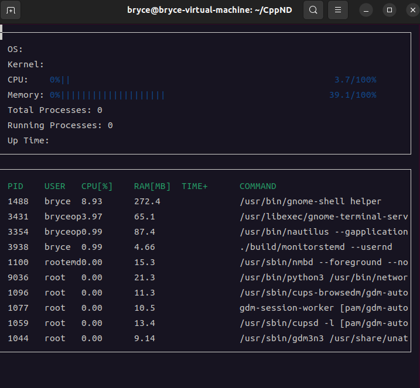

# Linux System Monitor

一个用 C++17 写的终端系统监视器，通过读取 Linux `/proc` 伪文件系统实时采集系统与进程状态，并用 ncurses 渲染成全屏刷新的字符界面——可以理解为终端里跑的一个极简版 `htop`。



*在 Ubuntu 虚拟机上实测的运行效果：CPU / 内存进度条与进程列表已正常工作，系统面板的 OS、Kernel、进程计数、Up Time 以及进程列表的 TIME+ 列尚未接入，具体见下方「功能实现状态」。*

## 项目简介

本项目的核心是"从内核暴露的文本接口里把数据抠出来"。`/proc` 下没有结构化的 API，只有一堆格式固定但细节很脏的文本文件（`/proc/stat`、`/proc/[pid]/stat`、`/proc/meminfo` ……），每个文件都能踩坑：字段位置会随内核版本漂移，进程名里可能带空格和括号，容器里的进程可能没有 cmdline。

项目把"解析"和"展示"彻底分层：

- `LinuxParser` 命名空间：只负责读文件、切字段、返回干净数据，不持有任何状态
- `Processor` / `Process` / `System`：领域对象，负责把原始计数器换算成使用率、维护采样历史
- `NCursesDisplay`：只做排版和刷新，不关心数据怎么来的

## 界面

界面分上下两个窗口，每秒重绘一次：

**系统面板**：操作系统名、内核版本、CPU 使用率进度条、内存使用率进度条、总进程数、运行中进程数、开机时长。

**进程面板**：按 CPU 占用从高到低排列的进程列表，包含 `PID`、`USER`、`CPU[%]`、`RAM[MB]`、`TIME+`、`COMMAND` 六列。

两点使用上的预期行为：首次绘制的 CPU 使用率一定是 `0%`，因为占用率需要两次采样求差，第二帧起才是真实值；窗口不响应尺寸变化，启动后请勿调整终端大小。

## 功能实现状态

| 模块 | 内容 | 状态 |
| --- | --- | --- |
| LinuxParser | 内存使用率 `MemoryUtilization()` | 已完成 |
| LinuxParser | 系统运行时长 `UpTime()` | 已完成 |
| LinuxParser | PID 枚举 `Pids()` | 已完成 |
| LinuxParser | CPU 时间采集 `CpuUtilization()` | 已完成 |
| LinuxParser | 进程 CPU 时间 `ActiveJiffies(pid)` | 已完成 |
| LinuxParser | 进程命令行 `Command(pid)` | 已完成 |
| LinuxParser | 进程内存 `Ram(pid)` | 已完成 |
| LinuxParser | 进程 UID / 用户名 `Uid()` / `User()` | 已完成 |
| LinuxParser | 进程运行时长 `UpTime(pid)` | 已完成 |
| LinuxParser | 系统级 `Jiffies()` / `ActiveJiffies()` / `IdleJiffies()` | 未实现（返回 0） |
| LinuxParser | `TotalProcesses()` / `RunningProcesses()` | 未实现（返回 0） |
| Processor | 聚合 CPU 使用率 `Utilization()` | 已完成 |
| Process | 单进程 CPU 使用率 `RefreshCpu()` | 已完成 |
| System | `MemoryUtilization()` / `Processes()` | 已完成 |
| System | `Kernel()` / `OperatingSystem()` / `UpTime()` | 未接入（返回空值） |
| Format | `ElapsedTime()` 秒数转 `HH:MM:SS` | 未实现（返回空串） |

> 也就是说：**CPU 与内存使用率、进程列表、进程级指标都已可用**；系统面板上的 OS / Kernel / 进程计数 / 开机时长目前仍是空值或 0，因为对应的 `System` 转发和格式化函数还没写完。

## 构建与运行

### 依赖

- Linux（依赖 `/proc`，无法在 macOS / Windows 上运行）
- g++（支持 C++17）或 clang++
- CMake 3.x（版本兼容性见下方说明）
- ncurses 开发库

```bash
# Debian / Ubuntu
sudo apt install build-essential cmake libncurses5-dev libncursesw5-dev

# Fedora / RHEL
sudo dnf install gcc-c++ cmake ncurses-devel
```

### 编译

```bash
make build
```

这会创建 `build/` 目录并执行 CMake 配置与编译；等价的手动方式是：

```bash
mkdir -p build && cd build
cmake .. && make
```

### 运行

```bash
./build/monitor
```

按 `Ctrl+C` 退出。窗口宽度不足时 `COMMAND` 列会被截断，建议终端至少 80 列。

### 其他 Make 目标

| 目标 | 作用 |
| --- | --- |
| `make build` | 编译（Release） |
| `make debug` | 带调试符号编译 |
| `make format` | 用 clang-format 格式化 `src/` 与 `include/` |
| `make clean` | 删除 `build/` 目录 |

### 关于 CMake 版本

`CMakeLists.txt` 里声明的是 `cmake_minimum_required(VERSION 2.6)`。CMake 3.27 之后已不再接受低于 3.5 的版本声明，如果你的 CMake 较新会看到兼容性报错，可以这样绕过：

```bash
cd build && cmake -DCMAKE_POLICY_VERSION_MINIMUM=3.5 .. && make
```

## 项目结构

```
.
├── CMakeLists.txt          # 构建配置，链接 ncurses，开启 -Wall -Wextra，C++17
├── Makefile                # build / debug / format / clean 目标
├── include/
│   ├── linux_parser.h      # /proc 解析接口与文件路径常量
│   ├── process.h           # 单个进程的领域对象
│   ├── processor.h         # CPU 聚合使用率
│   ├── system.h            # 系统门面，组合 Processor 与 Process 列表
│   ├── format.h            # 秒数格式化
│   └── ncurses_display.h   # 界面渲染
└── src/
    ├── main.cpp
    ├── linux_parser.cpp
    ├── process.cpp
    ├── processor.cpp
    ├── system.cpp
    ├── format.cpp
    └── ncurses_display.cpp
```

## 实现要点

**CPU 使用率必须靠两次采样求差。** `/proc/stat` 里的 `cpu` 行给出的是**开机以来的累计 jiffies**，不是瞬时占用率。`Processor::Utilization()` 缓存上一次的 `total` 与 `idle`，用 `(Δtotal - Δidle) / Δtotal` 得到区间内的真实占用率；首次调用以及检测到计数器回退（热插拔、溢出）时返回 0 并重置基线。

**解析 `/proc/[pid]/stat` 不能用空格切分。** 第二个字段是进程名，被一对括号包着，名字本身可能包含空格甚至右括号（比如 `(Web Content)`）。代码先用 `rfind(')')` 定位右括号，再从其后按字段序号取 `utime`(14)、`stime`(15)、`starttime`(22)，避开前面所有不可靠的分列。

**进程对象要跨轮次复用。** 如果每刷新一次就重建 `std::vector<Process>`，那每个进程的采样基线都会丢，CPU 使用率将永远是 0。`System::Processes()` 用 `unordered_map<pid, Process>` 把上一轮的对象按 PID 搬过来（`std::move` 转交采样状态），只为新出现的 PID 构造新对象，最后按 CPU 占用降序排序。

**用户名的两级回退。** `/proc/[pid]/status` 里只有数字 UID，需要 `getpwuid()` 映射成用户名；容器或已删除用户可能查不到，此时退回显示原始 UID，连 UID 都读不到则显示 `?`。

**命令行也是回退链。** `/cmdline` 用 `\0` 分隔参数，读进来把 `\0` 换成空格再裁掉尾部空白；内核线程的 `/cmdline` 是空的，于是退回读 `/comm`。

**内存单位。** `/proc/meminfo` 的 `MemAvailable` 与 `MemTotal` 单位都是 kB，用 `(MemTotal - MemAvailable) / MemTotal` 计算占用率——用 `MemFree` 会严重高估，因为页缓存也被算作"已用"。进程内存取 `VmRSS` 并换算成 MB。

## 待办

- [ ] `Format::ElapsedTime()`：把秒数格式化成 `HH:MM:SS`，目前返回空串，导致 `TIME+` 与 `Up Time` 列空白
- [ ] `System::Kernel()` / `OperatingSystem()`：`LinuxParser` 里已有可用实现，只差在 `System` 层转发
- [ ] `System::UpTime()` / `TotalProcesses()` / `RunningProcesses()`：接上解析层
- [ ] `LinuxParser::TotalProcesses()` / `RunningProcesses()`：从 `/proc/stat` 读 `processes` 与 `procs_running`
- [ ] `LinuxParser::Jiffies()` / `ActiveJiffies()` / `IdleJiffies()`：系统级计数器聚合
- [ ] `Pids()` 改用 `std::filesystem` 目录遍历，去掉 `<dirent.h>` 依赖
- [ ] 每帧重绘前对窗口调用 `werase()`：目前只画 `box()` 不清内容，数值变短时会残留上一帧的字符（实测表现为 `root` 与 `0.00` 挤成 `rootd0.00`）
- [ ] 加宽默认列距或按用户名长度动态排版，避免长用户名顶到 `CPU[%]` 列
- [ ] 补充 `.gitignore`，排除 `build/` 与编辑器临时文件
- [ ] 增加 CI，开启 `-Werror`

## 环境与许可

- 语言标准：C++17
- 平台：Linux（`/proc` 与 ncurses）
- 许可证：[MIT](LICENSE)，原始模板版权归 Udacity (c) 2019

本项目基于 [Udacity C++ Nanodegree](https://www.udacity.com/course/c-plus-plus-nanodegree--nd213)。
